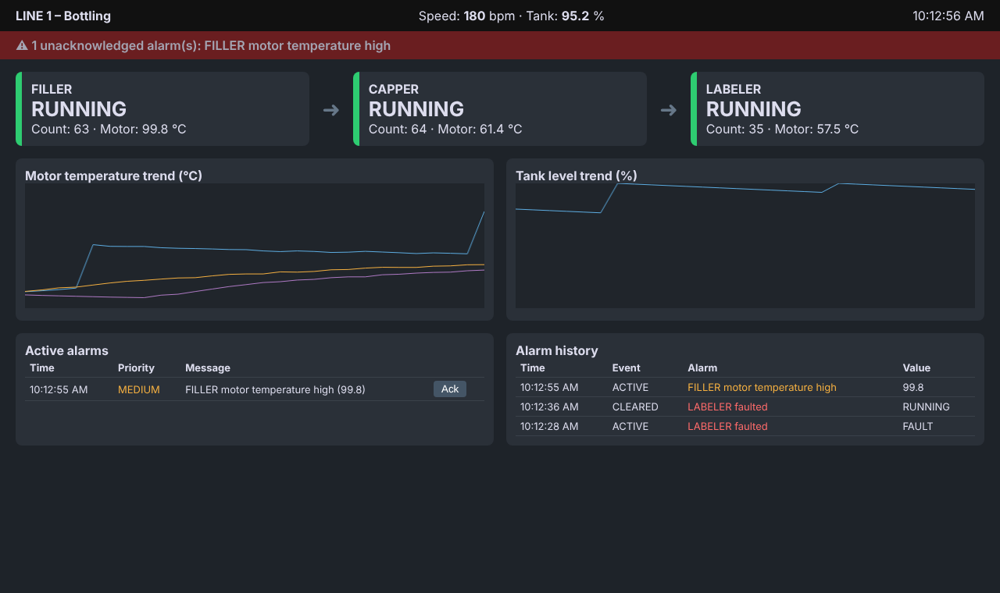

# SCADA / HMI Production Line Monitoring Simulation

A simulated 3-station bottling line with two ways to monitor it:

1. **Ignition SCADA (Perspective):** the simulator runs an **OPC-UA server**. Ignition connects to it, and a ready-made **tag import** (`ignition_tags.json`) creates the tags, alarms and history. See **[IGNITION_GUIDE.md](IGNITION_GUIDE.md)**.
2. **Built-in web HMI (Flask):** a lightweight HMI with live station status, trends, an alarm banner, acknowledgement and alarm history.



## How it works

```
line_simulator.py  ──writes──►  tags.py (Tag DB + Alarm manager)  ◄──REST──  hmi_app.py (web HMI)
 FILLER → CAPPER → LABELER        • latest value, quality, timestamp           • line overview
 states, counts, motor temps      • trend history buffer                       • trends
 random faults, overheating,      • alarm rules (gt / lt / eq)                 • alarm banner + Ack
 tank level, starvation           • ACTIVE → ACKED → CLEARED → SQLite log      • alarm history
```

### Tags

| Tag | Description |
|---|---|
| `FILLER/CAPPER/LABELER.State` | RUNNING / IDLE (starved) / FAULT |
| `*.Count` | Part counter |
| `*.MotorTemp` | Motor temperature (°C) |
| `LINE.Speed`, `LINE.TankLevel` | Line speed (bpm) and product tank level (%) |

### Alarms

| Alarm | Condition | Priority |
|---|---|---|
| `<STATION>_FAULT` | State = FAULT | HIGH |
| `<STATION>_TEMP_HI` | MotorTemp > 85 °C | MEDIUM |
| `TANK_LOW` | TankLevel < 15 % | MEDIUM |

Every alarm transition (ACTIVE, ACKED, CLEARED) is stored in `alarms.db`, which gives you an alarm journal for troubleshooting.

## Run it on Ignition

```bash
pip install -r requirements.txt
python opcua_server.py      # OPC-UA server: opc.tcp://localhost:4841/linesim/
docker compose up -d        # PostgreSQL for tag history + alarm journal
```

Then in Ignition: add an OPC-UA connection named `LineSim`, import `ignition_tags.json`, and build the Perspective views. The full steps are in [IGNITION_GUIDE.md](IGNITION_GUIDE.md).

| OPC-UA node | Ignition tag | Alarm |
|---|---|---|
| `ns=2;s=Line1/<STATION>/StateCode` | `Line1/<STATION>/StateCode` (Int4) | = 2 → HIGH "faulted" |
| `ns=2;s=Line1/<STATION>/MotorTemp` | `Line1/<STATION>/MotorTemp` (Float8, history) | > 85 °C → MEDIUM |
| `ns=2;s=Line1/<STATION>/Count` | `Line1/<STATION>/Count` (Int4, history) | — |
| `ns=2;s=Line1/LINE/TankLevel` | `Line1/LINE/TankLevel` (Float8, history) | < 15 % → MEDIUM |

## Run the built-in web HMI

```bash
pip install -r requirements.txt
python hmi_app.py        # open http://localhost:5000
pytest -q
```

## REST API

| Endpoint | Purpose |
|---|---|
| `GET /api/snapshot` | All tag values + active alarms |
| `GET /api/trend/<tag>` | Trend history for a tag |
| `POST /api/ack` `{"alarm": "FILLER_FAULT"}` | Acknowledge an alarm |
| `GET /api/history` | Alarm journal |

## Tech

Ignition (OPC-UA connection, tag import with alarms + history; Perspective screens per guide) · OPC-UA (asyncua) · PostgreSQL · Python · Flask · SQLite
